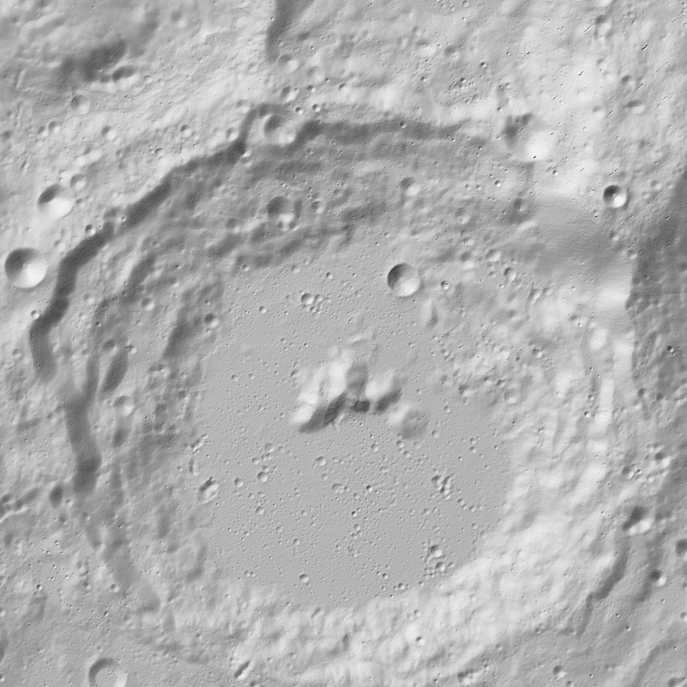

# ATLAS — Analog Terrain & Lunar Alignment System

**Team Binary Knights** · NASA Space Apps Challenge 2026
Challenge: **[Identify Earth Locations that Analog the Permanent Moon Base Locations and Mars](https://www.spaceappschallenge.org/2026/challenges/permanent-moon-base-locations-and-mars/)**

> Before NASA can build permanent bases at the lunar poles, every rover,
> habitat and drill has to be rehearsed somewhere on Earth. ATLAS measures
> the four planned Moon base sites directly from NASA LRO data, then goes
> looking for their Earth counterparts — and instead of re-listing the
> famous analog sites everyone already knows, it **discovers and ranks 14
> previously uncatalogued candidate sites across six terrain types**, with a
> fully transparent scoring model that anyone can re-weight live.

---

## The headline results

Each Moon base was profiled from real orbital data — elevation, slope,
roughness, permanent shadow, sunlight, Earth visibility and temperature —
and every Earth candidate was scored against every base (56 pairs):

| Moon base (measured profile) | Best Earth analog discovered | Score / 100 | Terrain |
|---|---|---:|---|
| **de Gerlache** — 88.5°S, 87.1°W · −184.4 °C seasonal mean | **Mount Erebus**, Antarctica (Ross Island) | **72.1** | Volcanic |
| **Shackleton** — 89.67°S, 129.78°E · −197.3 °C · 33.3% permanently shadowed · mean slope 19.42° | **Klyuchevskaya Volcanic Group**, Russia (Kamchatka) | **69.7** | Volcanic field |
| **Peary** — 88.63°N, 24.4°E · −223.8 °C · the coldest of the four | **Elgygytgyn Crater**, Russia (Chukotka) | **63.1** | Impact structure |
| **Amundsen** — 84.5°S · −200.8 °C | **Mount Erebus**, Antarctica (Ross Island) | **62.7** | Volcanic |

Scores are **rankings inside this candidate pool**, not absolute physical
equivalence — no place on Earth is as cold as the lunar poles, and ATLAS
says so openly (see *Limitations*). What the score gives mission planners
is a defensible, reproducible **shortlist**: where to field-test hardware
and train crews first, and exactly *why* each site ranks where it does.

### Why the ranking can be trusted — the validation control

Before the discovery run, the famous catalogued analogs (Atacama, Mauna
Loa/Kea, Haughton Crater, McMurdo Dry Valleys, Rio Tinto, Meteor Crater,
Svalbard, Wadi Rum, Pilbara, Iceland, Mojave) were scored with the same
untuned engine. It ranked **McMurdo #1 for three of the four bases and
Atacama #1 for Peary — the literature's own answers**, with no parameter
fitting. Only after that check were the classics **excluded by design**
(per Challenge Guide #09, which makes discovering *new* analogs the task)
and kept in the repo purely as the documented control run
([docs/06](docs/06_phase3_scoring_model.md), [docs/08](docs/08_validation_and_qa.md)).

### The four bases, as measured (LOLA shaded relief)

| Peary (N pole) | Shackleton (S pole) | de Gerlache (S pole) | Amundsen (S pole) |
|---|---|---|---|
|  |  |  |  |

---

## The discovery pool — 14 sites, 6 terrain types

| Terrain type | Sites |
|---|---|
| Arid basins | Lut Desert (Iran) · Qaidam Basin (China) · Badain Jaran Desert (China) |
| Salt flats | Etosha Pan (Namibia) · Salinas Grandes (Argentina) |
| Volcanic | Mount Erebus (Antarctica) · Deception Island (Antarctica) · Klyuchevskaya Volcanic Group (Russia) |
| Lava tubes (subterranean) | Undara (Australia) · Manjanggul, Jeju (South Korea) |
| Permafrost | Yamal Peninsula (Russia) |
| Impact structures | Elgygytgyn (Russia) · Lonar (India) · Tenoumer (Mauritania) |

Every site record carries a *discovery note* in the app explaining why it
is a credible new candidate. Lava-tube sites are profiled from their
surface terrain plus documented cave metadata — the app labels them as
such rather than pretending orbital data can see underground.

---

## How it works

```
NASA PDS / PGDA ──► download_data.sh ──► preprocess_moon.py ──┐
ESA Copernicus ────────────────────────► preprocess_earth.py ─┼─► model.py ──► outputs/ ──► web app + Streamlit app
NASA POWER / SoilGrids ────────────────►        ▲               │      (scores, rankings,
MGS MOLA (HTTP-range window) ──────────► preprocess_mars.py ────┘       radar plots, hillshades)
```

1. **Moon** (`src/preprocess_moon.py`) — LOLA gridded records (LDEM/LDSM/
   LDRM) for **both** poles, LPSR shadow masks, PGDA-69 illumination and
   Earth-visibility maps, and Diviner polar temperature tables are read
   directly from their PDS labels by a custom polar-stereographic engine
   (`src/atlas_common.py`) — no GIS black box.
2. **Earth** (`src/preprocess_earth.py`) — Copernicus DEM GLO-30 at native
   30 m (slope from Horn gradients inside a fixed 20 × 20 km box per site),
   NASA POWER climatology, SoilGrids 2.0 soil fractions.
3. **Mars** (`src/preprocess_mars.py`) — Jezero Crater measured from one
   MOLA MEGDR tile fetched as a ~3 MB HTTP-range window, not a bulk
   download. Same method, second planet: Jezero mean slope 2.92°, 93.1% of
   its area flatter than 10°.
4. **Scoring** (`src/model.py`) — the model below, plus K-Means (k = 3)
   clustering of sites into environmental regimes.

### The scoring model — transparent by design

Five pillars, weights fixed **before** the data was examined:

| Pillar | Weight | What it captures |
|---|---:|---|
| Mean slope | 30% | Rover traversability, landing safety |
| Area flatter than 10° | 20% | Room to build and operate |
| Temperature (seasonal mean) | 20% | Thermal environment |
| Soil / regolith proxy (sand, clay, coarse fragments) | 15% | Surface material behaviour |
| Relief (elevation std) | 15% | Terrain roughness at landscape scale |

Each variable is min–max normalised across Moon + Earth together;
dissimilarity is a weighted Euclidean distance over the pillars,
`Analog Score = 100 · exp(−D)`. Three honesty rules are built in:

- **Missing data is never scored as zero.** If a site has no source
  coverage for a pillar (e.g. SoilGrids has no data for Mount Erebus or
  Etosha Pan), that pillar is dropped for that pair and the remaining
  weights are renormalised — and the app *shows* the gap.
- **Sun % and Earth % are never scored.** They are displayed as mission
  context for each base, but Earth has no counterpart for them.
- **Weights are re-runnable, not sacred.** The app ships mission presets
  (Balanced / Rover mobility / Habitat & structures / Science & ISRU) and
  sliders that re-rank all 14 sites live from the stored per-factor
  distances — judges can test the model's sensitivity themselves.

---

## The web app — a mission-control console

The primary interface (`webapp/`) is a FastAPI backend + framework-free
HTML/CSS/JS frontend. The world map is the canvas; glass telemetry panels
float over it:

- **Selected Base** — the base's measured profile (shadow, sunlight,
  temperature) with its source line
- **Analog Ranking** — the live top matches for the selected base, with
  status flags (best match, soil-data gaps)
- **Model Health** — per-pillar data coverage across the pool, so gaps are
  visible instead of hidden
- **Mission Log** — a live event feed; real data gaps appear as ALERTS
- **Site Feed** — the #1 match locked over the base's *real LOLA
  hillshade*, with HUD tapes carrying its slope and temperature
- **Operator guide** — an info button (bottom-right) with a one-minute
  guide, in the same console language
- Full workspaces for **Bases** (all four measured profiles), **Finder**
  (presets + weight sliders + discovery notes + CSV downloads),
  **Compare** (per-factor radar; hollow markers = unscored pillars),
  **Mars** (Jezero + its closest Earth movers) and **Methodology**
- Fully responsive (phone = bottom tab bar, stacked console), keyboard
  accessible, Leaflet vendored locally — no CDN, no API keys anywhere;
  map tiles come from Google's free embedded tile service

**Run it locally:**

```bash
bash webapp/run.sh            # http://localhost:8000
curl localhost:8000/api/health
# {"status":"ok","moon_bases":4,"earth_sites":14,"score_rows":56}
```

**Deploy it (zero configuration):** the repo is Vercel-ready — root
`pyproject.toml` points Vercel at the FastAPI app and declares only its
light runtime dependencies (FastAPI + Markdown; the backend reads CSVs
with the standard library). Import the repo at
[vercel.com/new](https://vercel.com/new), or one-click:

[](https://vercel.com/new/clone?repository-url=https%3A%2F%2Fgithub.com%2Fabdulhayykhan%2FATLAS)

A Streamlit version of the same tool (`src/app.py`, six pages) is kept as
the analysis workbench — deployable at share.streamlit.io with
`src/app.py` as the entry point. Both apps read only `outputs/`; neither
needs the raw data, secrets, or API keys.

---

## Data — every layer cited, every link direct

| Layer | Source | Used for |
|---|---|---|
| LOLA GDR (LDEM / LDSM / LDRM) | [NASA PDS Geosciences](https://pds-geosciences.wustl.edu/lro/lro-l-lola-3-rdr-v1/lrolol_1xxx) | Moon elevation, slope, roughness — both poles |
| LOLA LPSR shadow maps | [NASA PDS Geosciences](https://pds-geosciences.wustl.edu/lro/lro-l-lola-3-rdr-v1/lrolol_1xxx) | Permanently shadowed % per base |
| Diviner Polar Cumulative Products | [NASA PDS](https://pds-geosciences.wustl.edu/lro/urn-nasa-pds-lro_diviner_derived1/data_derived_pcp/diurnal/) | Polar surface temperatures |
| Illumination & Earth-visibility maps (Mazarico et al. 2011) | [MIT / PGDA 69](http://imbrium.mit.edu/EXTRAS/ILLUMINATION/IMG/) | Sun % and Earth % per base |
| PGDA polar products catalog | [NASA GSFC](https://pgda.gsfc.nasa.gov/) | Polar DEM product identification |
| MOLA MEGDR | [NASA PDS](https://pds-geosciences.wustl.edu/mgs/mgs-m-mola-5-megdr-l3-v1/) | Mars — Jezero Crater |
| NASA POWER climatology | [NASA LaRC](https://power.larc.nasa.gov/) | Earth-site temperatures |
| Copernicus DEM GLO-30 | [ESA / Airbus](https://copernicus-dem-30m.s3.amazonaws.com/) | Earth elevation & slope at 30 m |
| SoilGrids 2.0 | [ISRIC](https://soilgrids.org) | Soil pillar (sand / clay / coarse fragments) |
| Basemap tiles | [Google Maps](https://www.google.com/maps) | Web-app basemap (free embedded tiles) |

The complete dataset record — product-by-product coverage, file sizes,
the v1 plan versus what was actually used, and the reasons for every
substitution — is in **[DATA_DOCUMENTATION.md](DATA_DOCUMENTATION.md)**.
Note what is *not* used, on purpose: the Diviner cylindrical products
cover only −60°…+60° latitude and contain no data at any polar base;
ETOPO was replaced by the finer Copernicus DEM; MODIS temperatures by
NASA POWER climatology.

---

## Reproduce the science

```bash
bash scripts/download_data.sh      # ~2.3 GB, all public, no login
pip install -r requirements.txt    # or: conda env create -f environment.yml
python src/preprocess_moon.py      # ~15 s  → outputs/moon_profiles.csv
python src/preprocess_earth.py     # → outputs/earth_profiles.csv
python src/preprocess_mars.py      # ~5 s   → outputs/mars_profiles.csv
python src/model.py                # → scores, rankings, radar plots
```

**Acceptance check:** `outputs/scores_ranking.csv` must reproduce the
four winners in the headline table exactly (72.1 / 69.7 / 63.1 / 62.7).
Step-by-step commands, expected numbers and a troubleshooting table:
[docs/09_reproduction_guide.md](docs/09_reproduction_guide.md).

---

## Built the hard way — traps found and fixed

The pipeline caught real data traps that silently corrupt results if
missed; each is documented with its evidence in
[docs/08_validation_and_qa.md](docs/08_validation_and_qa.md):

- **North-pole grids are stored with the opposite row handedness** to the
  south — proven by a crater-depression test; uncorrected, Peary's profile
  is a mirror image of reality.
- **LDSM DN = 0 is a no-data marker** (~29% of the polar cap), not 0°
  slope — excluding it moved Amundsen's mean slope from 15.21° to the
  correct 10.26°.
- **Shackleton's IAU centre is 89.67°S, 129.78°E** (the pole sits on its
  rim) — not the commonly copied 89.9°S, 0°E.
- **PGDA 81 covers only 87–90°S** — Amundsen (84.5°S) needs the 80S
  product; Peary needs the north-pole grids. Both poles are covered, no
  south-only shortcut.
- Diviner cold extremes are taken as the **1st percentile** — the raw
  minimum is a single outlier bin.

## Limitations — stated, not hidden

- **Temperature gap:** Earth candidates are far warmer than the
  −184…−224 °C bases; temperature therefore discriminates weakly and the
  scores must be read as within-pool rankings.
- **Resolution mismatch:** Moon slope is measured at 240 m, Earth terrain
  at 30 m; slope statistics are scale-sensitive.
- **Air vs surface temperature:** Earth values are 2 m air climatology;
  Moon values are surface bolometric temperatures.
- **Candidate pool, not a global scan:** 14 sites were profiled in depth
  rather than scanning every pixel on Earth.
- **Cave sites are surface-profiled**; their cave geometry comes from
  published surveys, not orbital data.
- **Roadmap (not claimed as done):** LEND neutron / M³ composition
  layers, LiDAR cave geometry, THEMIS Mars temperatures, GeoTIFF /
  shapefile exports (downloads are CSV today).

---

## Repository map

```text
ATLAS/
├── README.md                  # this file
├── DOCUMENTATION.md           # index of the full documentation set
├── DATA_DOCUMENTATION.md      # dataset record + direct data links (as built)
├── docs/00–12                 # phase-by-phase documentation (see DOCUMENTATION.md)
├── pyproject.toml             # Vercel deployment manifest (web runtime deps)
├── requirements.txt           # pipeline + Streamlit dependencies
├── environment.yml            # conda alternative
├── scripts/download_data.sh   # fetches all raw data (~2.3 GB, public)
├── src/
│   ├── atlas_common.py        # PDS3 label parser + polar-stereographic ROI engine
│   ├── preprocess_moon.py     # 4 lunar base profiles
│   ├── preprocess_earth.py    # 14 Earth site profiles
│   ├── preprocess_mars.py     # Jezero quick-look
│   ├── model.py               # scoring, ranking, regimes, radar plots
│   └── app.py                 # Streamlit app (6 pages)
├── outputs/                   # the science results both apps serve
│   ├── moon_profiles.csv · earth_profiles.csv · mars_profiles.csv
│   ├── scores_ranking.csv     # all 56 pairs
│   ├── hillshade_*.png        # LOLA shaded relief of the 4 bases
│   ├── radar_*.png            # per-base radar plots (Streamlit)
│   └── methodology.md         # method summary rendered inside both apps
└── webapp/
    ├── backend/main.py        # FastAPI JSON API over outputs/
    ├── frontend/              # mission-control console (vanilla HTML/CSS/JS)
    └── run.sh                 # local launcher
```

Raw data (`data/`, ~2.3 GB) is git-ignored by design and rebuilt by the
download script.

## Documentation

The complete step-by-step record — research, acquisition, processing,
scoring, both apps, validation, reproduction, Guide #09 compliance,
deployment and submission — is indexed in
**[DOCUMENTATION.md](DOCUMENTATION.md)**.

## Team Binary Knights

- **Muhammad Ubaid Idrees** — Team Lead · scoring pipeline, web
  application, integration and submission
- **Abdul Hayy Khan** — Repository host · dataset cataloguing and data
  documentation
- **Binary Knights members** — data research, candidate-site
  shortlisting, testing and QA

## Credits & attribution

LRO LOLA and Diviner: NASA Planetary Data System, Geosciences Node
(Washington University in St. Louis) and the Planetary Geology,
Geophysics and Geochemistry Data Archive (NASA GSFC). Illumination
modelling: Mazarico et al. (2011). Copernicus DEM GLO-30: © European
Space Agency / Airbus, via AWS Open Data. NASA POWER: NASA Langley
Research Center. SoilGrids 2.0: © ISRIC — World Soil Information
(CC BY 4.0). MGS MOLA MEGDR: NASA PDS. Basemap: © Google. Map library:
Leaflet (open source). NASA data is credited as data source only; this
project is a student entry to the NASA Space Apps Challenge 2026 and is
not affiliated with or endorsed by NASA.
