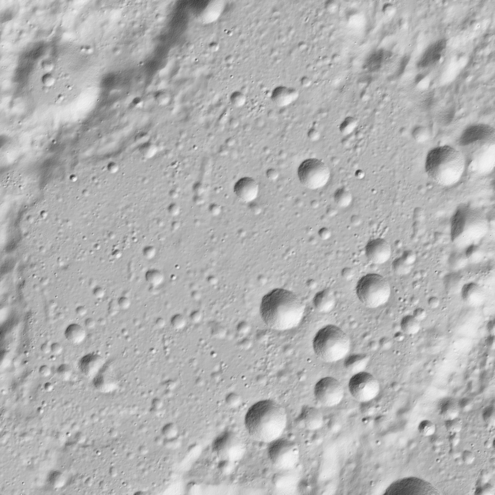
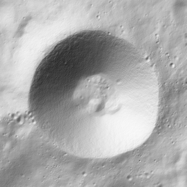
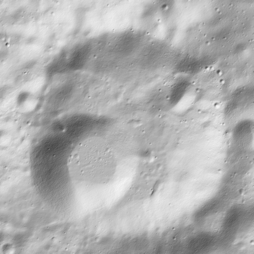
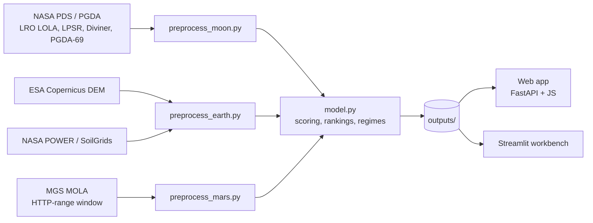

<div align="center">

# ATLAS

### Analog Terrain & Lunar Alignment System

**Which places on Earth best match the four planned permanent Moon bases?**
Measured from NASA orbital data. Ranked by one transparent, re-weightable score.

[](https://www.spaceappschallenge.org/2026/challenges/permanent-moon-base-locations-and-mars/)
[](https://atlas-ten-tan.vercel.app)


**Team Binary Knights** · Challenge #09: *Identify Earth Locations that Analog the Permanent Moon Base Locations and Mars*

**[Live demo](https://atlas-ten-tan.vercel.app)** · **[Documentation](DOCUMENTATION.md)** · **[Data record](DATA_DOCUMENTATION.md)** · **[Reproduce](docs/09_reproduction_guide.md)**

</div>

---

## Contents

[The idea](#the-idea) · [Headline results](#headline-results) · [Validation](#validation-the-control-run) · [Discovery pool](#the-discovery-pool) · [How it works](#how-it-works) · [Scoring model](#the-scoring-model) · [Web app](#the-web-app) · [Quick start](#quick-start) · [Data](#data-sources) · [Traps fixed](#built-the-hard-way) · [Limitations](#limitations) · [Repository map](#repository-map) · [Team](#team) · [Credits](#credits-and-attribution)

---

## The idea

Before NASA builds permanent bases at the lunar poles, every rover, habitat and drill has to be rehearsed somewhere on Earth. Today that choice leans on a handful of famous sites, and the Earth and planetary datasets needed to compare them live in separate repositories.

ATLAS closes that gap. It:

1. **Measures** the four planned Moon base sites directly from NASA LRO data.
2. **Discovers** 14 previously uncatalogued candidate sites across six terrain types, instead of re-listing the classics.
3. **Scores** all 56 base × site pairs with a fully transparent model that anyone can re-weight live.

| | |
|---|---|
| **4** Moon bases | **14** Earth candidates |
| **6** terrain types | **56** scored pairs |
| **5** open data repositories | **0** hand-entered site facts |

---

## Headline results

Each Moon base was profiled from real orbital data (elevation, slope, roughness, permanent shadow, sunlight, Earth visibility, temperature), and every Earth candidate was scored against every base.

| Moon base (measured) | Best Earth analog discovered | Score / 100 | Terrain |
|---|---|---:|---|
| **de Gerlache** · 88.5°S, 87.1°W · −184.4 °C seasonal mean | **Mount Erebus**, Antarctica | **72.1** | Volcanic |
| **Shackleton** · 89.67°S, 129.78°E · −197.3 °C · 33.3% shadowed · 19.42° mean slope | **Klyuchevskaya Volcanic Group**, Russia | **69.7** | Volcanic field |
| **Peary** · 88.63°N, 24.4°E · −223.8 °C (coldest of the four) | **Elgygytgyn Crater**, Russia | **63.1** | Impact structure |
| **Amundsen** · 84.5°S · −200.8 °C | **Mount Erebus**, Antarctica | **62.7** | Volcanic |

> **How to read the scores.** They are rankings *inside this candidate pool*, not absolute physical equivalence: no place on Earth is as cold as the lunar poles, and ATLAS says so openly (see [Limitations](#limitations)). What the score gives mission planners is a defensible, reproducible **shortlist** of where to field-test hardware and train crews first, and exactly *why* each site ranks where it does.

**The pattern makes physical sense.** The three steep, cold, high-relief south-pole bases match polar and subarctic volcanoes, while Peary, the flattest base, matches a flat-floored polar impact crater.

### The four bases, as measured (LOLA shaded relief)

| Peary (N pole) | Shackleton (S pole) | de Gerlache (S pole) | Amundsen (S pole) |
|---|---|---|---|
|  |  |  |  |

---

## Validation: the control run

Can the engine be trusted? Before the discovery run, the famous catalogued analogs (Atacama, Mauna Loa/Kea, Haughton Crater, McMurdo Dry Valleys, Rio Tinto, Meteor Crater, Svalbard, Wadi Rum, Pilbara, Iceland, Mojave) were scored with the same **untuned** engine.

| Moon base | Control-run #1 |
|---|---|
| Shackleton | McMurdo Dry Valleys (65.5) |
| de Gerlache | McMurdo Dry Valleys (70.2) |
| Amundsen | McMurdo Dry Valleys (59.2) |
| Peary | Atacama Desert (64.3) |

It rediscovered the literature's own answers with no parameter fitting. Only then were the classics **excluded by design** (Challenge Guide #09 makes discovering *new* analogs the task) and kept in the repo as the documented control run. See [docs/06](docs/06_phase3_scoring_model.md) and [docs/08](docs/08_validation_and_qa.md).

---

## The discovery pool

14 sites, 6 terrain types:

| Terrain type | Sites |
|---|---|
| Arid basins | Lut Desert (Iran) · Qaidam Basin (China) · Badain Jaran Desert (China) |
| Salt flats | Etosha Pan (Namibia) · Salinas Grandes (Argentina) |
| Volcanic | Mount Erebus (Antarctica) · Deception Island (Antarctica) · Klyuchevskaya Volcanic Group (Russia) |
| Lava tubes (subterranean) | Undara (Australia) · Manjanggul, Jeju (South Korea) |
| Permafrost | Yamal Peninsula (Russia) |
| Impact structures | Elgygytgyn (Russia) · Lonar (India) · Tenoumer (Mauritania) |

Every site record carries a *discovery note* in the app explaining why it is a credible new candidate. Lava-tube sites are profiled from surface terrain plus documented cave metadata, and the app labels them as such rather than pretending orbital data can see underground.

---

## How it works



1. **Moon** (`src/preprocess_moon.py`): LOLA gridded records (LDEM/LDSM/LDRM) for **both** poles, LPSR shadow masks, PGDA-69 illumination and Earth-visibility maps, and Diviner polar temperature tables, read directly from their PDS labels by a custom polar-stereographic engine (`src/atlas_common.py`). No GIS black box.
2. **Earth** (`src/preprocess_earth.py`): Copernicus DEM GLO-30 at native 30 m (slope from Horn gradients inside a fixed 20 × 20 km box per site), NASA POWER climatology and SoilGrids 2.0 soil fractions.
3. **Mars** (`src/preprocess_mars.py`): Jezero Crater from one MOLA MEGDR tile, fetched as a ~3 MB HTTP-range window rather than a bulk download. Same method, second planet: mean slope 2.92°, with 93.1% of the area flatter than 10°.
4. **Scoring** (`src/model.py`): the model below, plus K-Means (k = 3) clustering of sites into environmental regimes.

---

## The scoring model

Five pillars, with weights fixed **before** the data was examined:

| Pillar | Weight | What it captures |
|---|---:|---|
| Mean slope | 30% | Rover traversability, landing safety |
| Area flatter than 10° | 20% | Room to build and operate |
| Temperature (seasonal mean) | 20% | Thermal environment |
| Soil / regolith proxy (sand, clay, coarse fragments) | 15% | Surface material behaviour |
| Relief (elevation std) | 15% | Terrain roughness at landscape scale |

Each variable is min-max normalised across Moon and Earth together. Dissimilarity is a weighted Euclidean distance over the pillars:

```
D = sqrt( sum(w_k * d_k^2) / sum(w_k) )
Analog Score = 100 * exp(-D)        # 100 means identical
```

**Three honesty rules are built in**

- **Missing data is never scored as zero.** If a site has no source coverage for a pillar (SoilGrids has no data for Mount Erebus or Etosha Pan, for example), that pillar is dropped for that pair and the remaining weights are renormalised. The app *shows* the gap.
- **Sun % and Earth % are never scored.** They appear as mission context for each base, but Earth has no counterpart for them.
- **Weights are re-runnable, not sacred.** The app ships mission presets (Balanced, Rover mobility, Habitat & structures, Science & ISRU) and sliders that re-rank all 14 sites live from the stored per-factor distances, so judges can test the model's sensitivity themselves.

---

## The web app

A mission-control console (`webapp/`): a FastAPI backend and a framework-free HTML/CSS/JS frontend, with the world map as the canvas and glass telemetry panels floating over it.

| Panel | What it shows |
|---|---|
| **Selected Base** | The base's measured profile (shadow, sunlight, temperature) with its source line |
| **Analog Ranking** | Live top matches for the base, with status flags (best match, soil-data gaps) |
| **Model Health** | Per-pillar data coverage across the pool, so gaps are visible instead of hidden |
| **Mission Log** | A live event feed; real data gaps appear as alerts |
| **Site Feed** | The #1 match locked over the base's *real LOLA hillshade*, with HUD tapes for slope and temperature |

Full workspaces: **Bases** (all four measured profiles), **Finder** (presets, weight sliders, discovery notes, CSV downloads), **Compare** (per-factor radar; hollow markers are unscored pillars), **Mars** (Jezero and its closest Earth movers) and **Methodology**.

Fully responsive (phone gets a bottom tab bar), keyboard accessible, Leaflet vendored locally with no CDN and no API keys. Map tiles come from Google's free embedded tile service. A Streamlit version of the same tool (`src/app.py`, six pages) is kept as the analysis workbench. Both apps read only `outputs/`.

---

## Quick start

**Run the app locally**

```bash
bash webapp/run.sh                 # http://localhost:8000
curl localhost:8000/api/health
# {"status":"ok","moon_bases":4,"earth_sites":14,"score_rows":56}
```

**Deploy (zero configuration).** The repo is Vercel-ready: the root `pyproject.toml` points Vercel at the FastAPI app and declares only its light runtime dependencies. Import the repo at [vercel.com/new](https://vercel.com/new) or use the button:

[](https://vercel.com/new/clone?repository-url=https%3A%2F%2Fgithub.com%2Fabdulhayykhan%2FATLAS)

The Streamlit workbench deploys at share.streamlit.io with `src/app.py` as the entry point.

**Reproduce the science**

```bash
bash scripts/download_data.sh      # ~2.3 GB, all public, no login
pip install -r requirements.txt    # or: conda env create -f environment.yml
python src/preprocess_moon.py      # ~15 s  -> outputs/moon_profiles.csv
python src/preprocess_earth.py     #        -> outputs/earth_profiles.csv
python src/preprocess_mars.py      # ~5 s   -> outputs/mars_profiles.csv
python src/model.py                #        -> scores, rankings, radar plots
```

**Acceptance check:** `outputs/scores_ranking.csv` must reproduce the four winners in the headline table exactly (72.1 / 69.7 / 63.1 / 62.7). Full commands, expected numbers and troubleshooting are in [docs/09_reproduction_guide.md](docs/09_reproduction_guide.md).

---

## Data sources

Every layer is cited with a direct link.

| Layer | Source | Used for |
|---|---|---|
| LOLA GDR (LDEM / LDSM / LDRM) | [NASA PDS Geosciences](https://pds-geosciences.wustl.edu/lro/lro-l-lola-3-rdr-v1/lrolol_1xxx) | Moon elevation, slope, roughness, both poles |
| LOLA LPSR shadow maps | [NASA PDS Geosciences](https://pds-geosciences.wustl.edu/lro/lro-l-lola-3-rdr-v1/lrolol_1xxx) | Permanently shadowed % per base |
| Diviner Polar Cumulative Products | [NASA PDS](https://pds-geosciences.wustl.edu/lro/urn-nasa-pds-lro_diviner_derived1/data_derived_pcp/diurnal/) | Polar surface temperatures |
| Illumination & Earth-visibility maps (Mazarico et al. 2011) | [MIT / PGDA 69](http://imbrium.mit.edu/EXTRAS/ILLUMINATION/IMG/) | Sun % and Earth % per base |
| PGDA polar products catalog | [NASA GSFC](https://pgda.gsfc.nasa.gov/) | Polar DEM product identification |
| MOLA MEGDR | [NASA PDS](https://pds-geosciences.wustl.edu/mgs/mgs-m-mola-5-megdr-l3-v1/) | Mars: Jezero Crater |
| NASA POWER climatology | [NASA LaRC](https://power.larc.nasa.gov/) | Earth-site temperatures |
| Copernicus DEM GLO-30 | [ESA / Airbus](https://copernicus-dem-30m.s3.amazonaws.com/) | Earth elevation and slope at 30 m |
| SoilGrids 2.0 | [ISRIC](https://soilgrids.org) | Soil pillar (sand / clay / coarse fragments) |
| Basemap tiles | [Google Maps](https://www.google.com/maps) | Web-app basemap |

The complete record (product-by-product coverage, file sizes, the v1 plan versus what was used, and the reason for every substitution) is in **[DATA_DOCUMENTATION.md](DATA_DOCUMENTATION.md)**. Not used, on purpose: the Diviner cylindrical products cover only −60° to +60° latitude and contain no data at any polar base; ETOPO was replaced by the finer Copernicus DEM; MODIS temperatures by NASA POWER climatology.

---

## Built the hard way

The pipeline caught real data traps that silently corrupt results if missed. Each is documented with evidence in [docs/08_validation_and_qa.md](docs/08_validation_and_qa.md).

| Trap | Fix and effect |
|---|---|
| **North-pole grids use the opposite row handedness** to the south | Proven by a crater-depression test (7,428 m vs 2,051 m). Uncorrected, Peary's profile is a mirror image of reality |
| **LDSM DN = 0 is no-data** (~29% of the polar cap), not 0° slope | Excluding it moved Amundsen's mean slope from 15.21° to the correct 10.26° |
| **Shackleton's IAU centre is 89.67°S, 129.78°E** (the pole sits on its rim) | Not the commonly copied 89.9°S, 0°E; shadowed area rose from 24.7% to 33.3% |
| **PGDA 81 covers only 87–90°S** | Amundsen (84.5°S) needs the 80S product, and Peary needs the north-pole grids |
| **Diviner raw minimum is a single outlier bin** | Cold extremes use the 1st percentile |

---

## Limitations

Stated, not hidden.

- **Temperature gap.** Earth candidates are far warmer than the −184 to −224 °C bases, so temperature discriminates weakly. Read scores as within-pool rankings.
- **Resolution mismatch.** Moon slope is measured at 240 m and Earth terrain at 30 m, and slope statistics are scale-sensitive.
- **Air vs surface temperature.** Earth values are 2 m air climatology; Moon values are surface bolometric temperatures.
- **Candidate pool, not a global scan.** 14 sites were profiled in depth rather than scanning every pixel on Earth.
- **Cave sites are surface-profiled.** Cave geometry comes from published surveys, not orbital data.

**Roadmap (not claimed as done):** LEND neutron and M³ composition layers, LiDAR cave geometry, THEMIS Mars temperatures, GeoTIFF / shapefile exports (downloads are CSV today), and a global ETOPO / MODIS scan.

---

## Repository map

```text
ATLAS/
├── README.md                  # this file
├── DOCUMENTATION.md           # index of the full documentation set
├── DATA_DOCUMENTATION.md      # dataset record + direct data links (as built)
├── docs/00–12                 # phase-by-phase documentation
├── pyproject.toml             # Vercel deployment manifest (web runtime deps)
├── requirements.txt           # pipeline + Streamlit dependencies
├── environment.yml            # conda alternative
├── scripts/download_data.sh   # fetches all raw data (~2.3 GB, public)
├── src/
│   ├── atlas_common.py        # PDS3 label parser + polar-stereographic ROI engine
│   ├── preprocess_moon.py     # 4 lunar base profiles
│   ├── preprocess_earth.py    # 14 Earth site profiles
│   ├── preprocess_mars.py     # Jezero quick-look
│   ├── model.py               # scoring, ranking, regimes, radar plots
│   └── app.py                 # Streamlit app (6 pages)
├── outputs/                   # the science results both apps serve
│   ├── moon_profiles.csv · earth_profiles.csv · mars_profiles.csv
│   ├── scores_ranking.csv     # all 56 pairs
│   ├── hillshade_*.png        # LOLA shaded relief of the 4 bases
│   ├── radar_*.png            # per-base radar plots (Streamlit)
│   └── methodology.md         # method summary rendered inside both apps
└── webapp/
    ├── backend/main.py        # FastAPI JSON API over outputs/
    ├── frontend/              # mission-control console (vanilla HTML/CSS/JS)
    └── run.sh                 # local launcher
```

Raw data (`data/`, ~2.3 GB) is git-ignored by design and rebuilt by the download script.

---

## Team

**Team Binary Knights**: Muhammad Ubaid · Maryam Sohail · Muhammad Fasih · Mariyam · Abdul Hayy Khan 

Built at the NASA Space Apps Challenge 2026, Karachi.

## Credits and attribution

LRO LOLA and Diviner: NASA Planetary Data System, Geosciences Node (Washington University in St. Louis) and the Planetary Geology, Geophysics and Geochemistry Data Archive (NASA GSFC). Illumination modelling: Mazarico et al. (2011). Copernicus DEM GLO-30: © European Space Agency / Airbus, via AWS Open Data. NASA POWER: NASA Langley Research Center. SoilGrids 2.0: © ISRIC, World Soil Information (CC BY 4.0). MGS MOLA MEGDR: NASA PDS. Basemap: © Google. Map library: Leaflet (open source).

NASA data is credited as data source only. This project is a student entry to the NASA Space Apps Challenge 2026 and is not affiliated with or endorsed by NASA.
